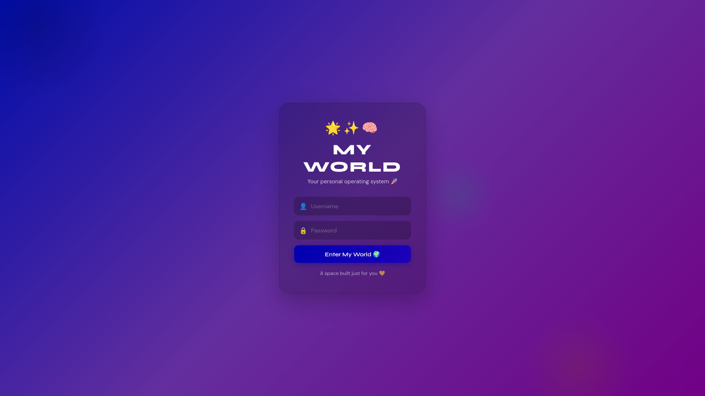
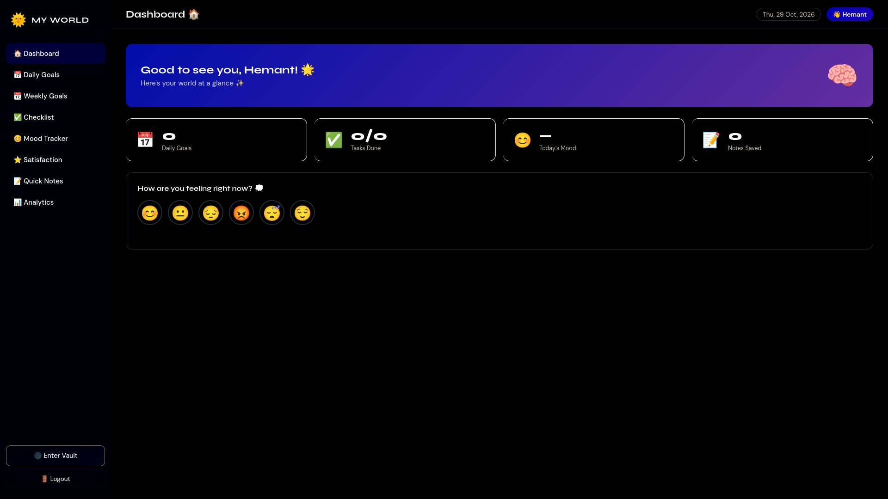
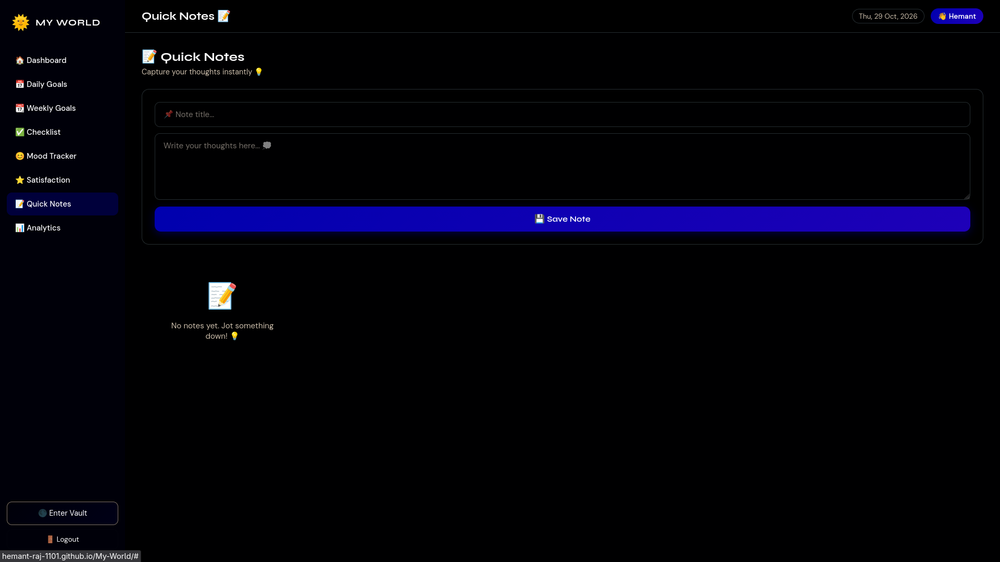
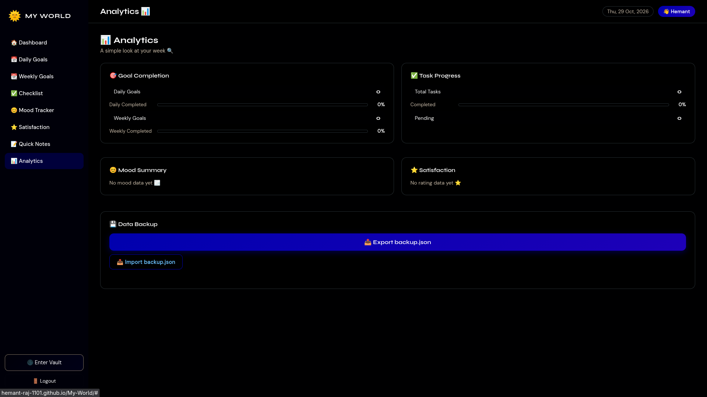
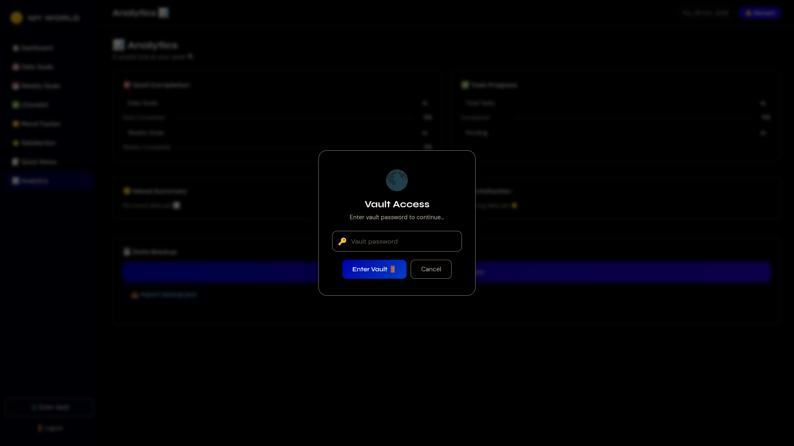
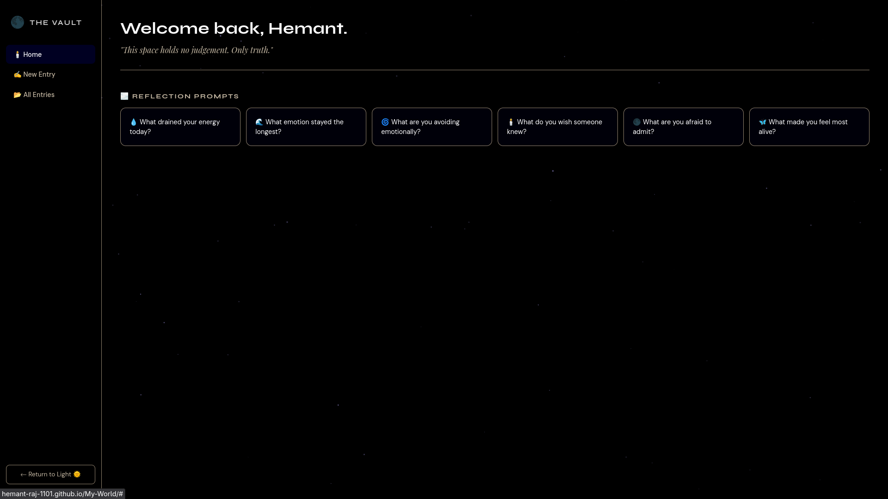
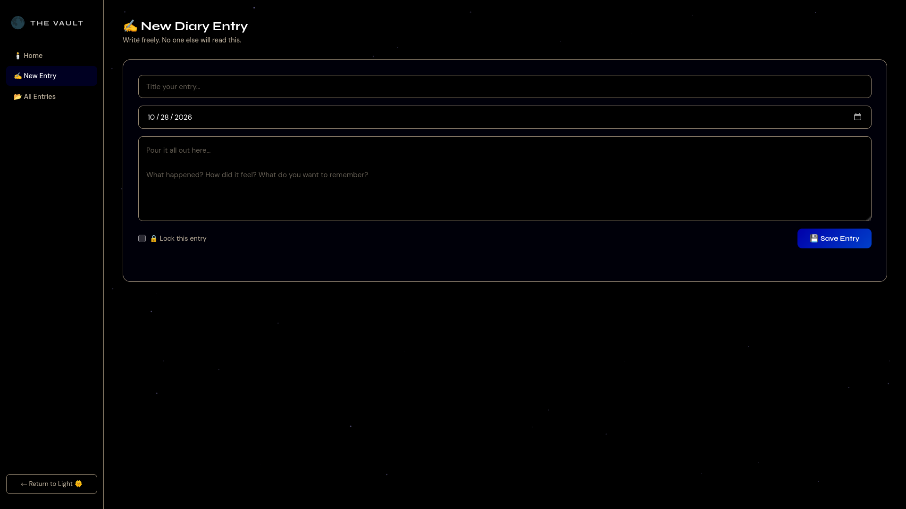

<div align="center">

# 🌟 MY WORLD ✨🧠

### Your personal operating system 🚀

*A calm, private space to plan your days, track your mood, capture your thoughts, and be honest with yourself.* 💛

<br/>

[](https://hemant-raj-1101.github.io/My-World/)


<br/>



</div>

---

## 📖 About

**My World** is a personal growth web app that puts everything you need to understand and improve yourself in one place. 🌱

It is built around one simple idea: **growth starts with awareness.** 🔍
You set goals 🎯, finish tasks ✅, notice how you feel 😊, rate your day ⭐, jot down thoughts 📝, and, when you need to be completely honest, you step into **The Vault** 🌑 and write freely.

No ads. No noise. No one watching. Just you and your world. 💛

---

## 🖼️ Screenshots

### 🏠 Dashboard: your world at a glance



Your goals, tasks, mood, and notes in one clean overview, with a one-tap mood check-in. 😊

<br/>

### 📝 Quick Notes: capture thoughts instantly



<br/>

### 📊 Analytics: see your progress



Track goal completion, task progress, mood trends, satisfaction, and back up your data. 💾

<br/>

### 🌑 The Vault: your private, honest space

<table>
  <tr>
    <td width="33%" align="center"><b>🔑 Vault Access</b><br/></td>
    <td width="33%" align="center"><b>🕯️ Vault Home</b><br/></td>
    <td width="33%" align="center"><b>✍️ New Diary Entry</b><br/></td>
  </tr>
</table>

---

## ✨ Features

### 🔐 Login
- 👤 Personal username and password screen
- 💜 A welcoming glass-style interface with a gradient background
- 👋 Personalised greeting once you're in

### 🏠 Dashboard
- 🌟 Friendly welcome banner with your name
- 📅 **Daily Goals** counter
- ✅ **Tasks Done** counter (for example `3/5`)
- 😊 **Today's Mood** at a glance
- 📝 **Notes Saved** counter
- 💭 One-tap mood check-in: *"How are you feeling right now?"* with six emotions (😊 😐 😔 😡 😴 😌)
- 🗓️ Live date display

### 🎯 Goals
- 📅 **Daily Goals**: what matters today
- 📆 **Weekly Goals**: the bigger picture for the week
- 📈 Completion percentage shown for both

### ✅ Checklist
- 🧾 Simple task list to tick things off
- ⏳ Pending vs completed tracking feeds the analytics

### 😊 Mood Tracker
- 🎭 Log how you feel, any time
- 🔁 Mood history builds up into a summary so patterns become visible

### ⭐ Satisfaction
- 🌙 Rate how satisfied you feel with your day
- 📉 Ratings roll up into your analytics

### 📝 Quick Notes
- 📌 Title and free-text body
- 💾 Save instantly, no friction
- 💡 Perfect for ideas, reminders, and random thoughts

### 📊 Analytics
- 🎯 **Goal Completion**: daily and weekly progress bars
- ✅ **Task Progress**: total, completed, pending
- 😊 **Mood Summary**: your emotional trends
- ⭐ **Satisfaction**: your rating history
- 💾 **Data Backup**: export and import your data as `backup.json`

### 🌑 The Vault (private diary)
- 🔑 Separate **vault password** to enter
- 🕯️ **Reflection prompts** to help you start writing:
  - 💧 What drained your energy today?
  - 🌊 What emotion stayed the longest?
  - 🌀 What are you avoiding emotionally?
  - 🕯️ What do you wish someone knew?
  - 🌑 What are you afraid to admit?
  - 🦋 What made you feel most alive?
- ✍️ **New Entry**: title, date, and a big writing area
- 🔒 **Lock this entry** option for extra privacy
- 📂 **All Entries** to look back on your journey
- 🌟 Calm starry dark theme, with *"Return to Light"* to step back out

---

## 🌱 Why This Project Matters for Personal Growth

Most apps track one thing. **My World** connects the whole picture, and that is what makes real change possible. 💪

| 🌟 Idea | 💡 How My World helps |
|---|---|
| 🎯 **Clarity** | Daily and weekly goals turn vague wishes into clear targets |
| 🔁 **Consistency** | Small daily check-ins build habits, and habits build identity |
| 😊 **Emotional awareness** | Mood tracking shows *when* and *why* you feel the way you do |
| 📈 **Self-measurement** | What gets measured gets improved. Analytics make progress visible |
| 🪞 **Honest reflection** | The Vault gives a judgement-free place to face what you usually avoid |
| 🧠 **Mental clarity** | Writing thoughts down clears your head and reduces overthinking |
| 💪 **Motivation** | Seeing progress bars fill and tasks complete keeps you going |
| 🧭 **Direction** | Reviewing moods, ratings, and entries over time shows where to change course |
| 🔒 **Safety to be real** | Privacy lets you be fully honest, and honesty is where growth begins |

> 💛 *"You can't change what you don't notice."* My World helps you notice. 🔍

### 🚀 It is also a real developer project

Building My World is personal growth in a second way: it is a **hands-on project** that turns learning into something real. 🛠️
- 💻 Practising **HTML, CSS and JavaScript** end to end
- 🎨 Designing a polished, responsive **UI/UX**
- 🧩 Managing app state, data storage, backup and import
- 🌍 Deploying a live site with **GitHub Pages**

---

## 🛠️ Tech Stack

| 🧱 Layer | 🔧 Tech |
|---|---|
| 🏗️ Structure | HTML5 |
| 🎨 Styling | CSS3 (glassmorphism, gradients, dark theme) |
| ⚡ Logic | Vanilla JavaScript |
| 🌍 Hosting | GitHub Pages |

---

## 📂 Project Structure

```
My-World/
├── 📄 index.html     # app structure and screens
├── ⚡ script.js      # logic: goals, mood, notes, vault, analytics, backup
├── 🎨 style.css      # themes and layout
├── 🖼️ screenshots/   # images used in this README
└── 📘 README.md
```

---

## 🚀 Getting Started

### 🌍 Use it online
👉 **[hemant-raj-1101.github.io/My-World](https://hemant-raj-1101.github.io/My-World/)**

### 💻 Run it locally

```bash
# 1️⃣ Clone the repo
git clone https://github.com/Hemant-Raj-1101/My-World.git

# 2️⃣ Go into the folder
cd My-World

# 3️⃣ Open index.html in your browser 🎉
xdg-open index.html     # Linux
# open index.html       # macOS
# start index.html      # Windows
```

No installs. No build step. Just open and go. ✨

---

## 🔒 Privacy Note

🛡️ My World is a **static web app**, so there is no account server and nothing to sign up for.
💾 Use **Analytics → Export backup.json** regularly to keep a safe copy of your data.
🔑 The vault password keeps your diary away from casual eyes. For highly sensitive content, keep your device itself locked and protected too.

---

## 🗺️ Roadmap Ideas

- [ ] 🔥 Streaks for daily goals and journaling
- [ ] 📅 Calendar view of moods and entries
- [ ] 📈 Mood and satisfaction charts over time
- [ ] 🔔 Gentle reminders for daily check-ins
- [ ] 🌗 Theme switcher
- [ ] 📱 Install as a mobile app (PWA)

---

## 🤝 Contributing

Ideas and suggestions are always welcome! 💡
Open an issue 🐛 or send a pull request 🔀. Every bit of feedback helps My World grow. 🌱

---

## 👨‍💻 Author

**Hemant Raj** 🧑‍💻
🎓 ECE student at VIT Bhopal &nbsp;|&nbsp; 🔌 Digital Design, FPGA & VLSI enthusiast

[](https://github.com/Hemant-Raj-1101)
[](https://www.linkedin.com/in/hemant-raj-b54438380)

---

<div align="center">

### 💛 A space built just for you 💛

**Still exploring 🔍 · Still experimenting 🛠️ · Still improving 📈**

⭐ If you like this project, give it a star! ⭐

</div>
